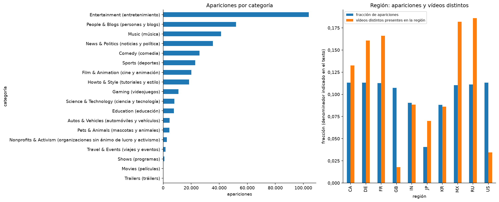

# Machine Learning aplicado a YouTube Trending

Proyecto académico de **Joaquín Fernández Lobato**, desarrollado en el Máster de Inteligencia Artificial de Atrium. Recorre el proceso de preparación de datos, análisis exploratorio, comparación y selección de algoritmos, evaluación e inferencia con modelos guardados.

Trabaja con **361.234 apariciones de 184.286 vídeos en diez listas regionales de tendencias**. Una aparición es un registro de un vídeo en una lista y una fecha; un mismo vídeo puede aparecer varias veces. Las regiones representan listas de tendencias, no la nacionalidad de los creadores.

Esta publicación conserva la versión académica entregada: **19 celdas de código ejecutadas, sin errores, 25 figuras y siete modelos**. La carpeta [`practica/`](practica/) reproduce los 103 archivos del ZIP final sin modificar sus contenidos ni reentrenar los modelos.

## Por dónde empezar

1. **Análisis y conclusiones:** [cuaderno ejecutado](practica/exploratory_analysis.ipynb). Sus tablas, gráficos e interpretaciones están guardados; leerlo no requiere ejecutar el entrenamiento.
2. **Resultados de las siete tareas:** [resumen de resultados](practica/reports/results.md) e [informe detallado](practica/reports/results_details.md).
3. **Cómo ejecutarlo:** [guía de la entrega](practica/README.md), con preparación del entorno, datos e instrucciones del menú.
4. **Qué permite concluir y qué mejoraría:** [alcance y próximos pasos](docs/ALCANCE_Y_MEJORAS.md).



## Problemas y resultados

Se desarrollan cuatro problemas principales y dos retos opcionales; la moderación se divide en comentarios y valoraciones, dando siete tareas.

| Tarea | Modelo final | Resultado de la evaluación interna | Referencia |
|---|---|---:|---:|
| Categoría del vídeo | Máquina de vectores de soporte lineal (SVM) | Macro-F1: **0,527** | 0,025 |
| Comentarios desactivados | SVM con umbral ajustado en desarrollo | Macro-F1: **0,670** | 0,495 |
| Valoraciones desactivadas | Regresión logística con umbral ajustado en desarrollo | Macro-F1: **0,591** | 0,495 |
| Número de «me gusta» | Regresión de vectores de soporte con objetivo logarítmico | Error absoluto medio (MAE): **14.202,119 likes** | 57.088,142 likes |
| Proporción de «me gusta» y «no me gusta» | Regresión Ridge con objetivo logarítmico | MAE: **26,984** | 32,116 |
| Segmentación | KMeans con dos grupos y reducción de dimensionalidad | Silueta: **0,2022** | Comparación de alternativas en el cuaderno |
| Recomendación por contenido | TF-IDF de caracteres y vecinos por similitud coseno | Coincidencia editorial: **44,60 %** | Azar esperado: 14,32 % |

Macro-F1 promedia el rendimiento por clase dando el mismo peso a cada una: un valor mayor es mejor. MAE mide el tamaño medio del error en las unidades del objetivo: menor es mejor. La silueta describe separación y cohesión de los grupos; no acredita su utilidad temática. La coincidencia editorial del recomendador comprueba categorías compartidas, **no satisfacción humana ni exactitud de un clasificador**.

Las métricas del recomendador corresponden al catálogo de evaluación de 6.000 vídeos. El catálogo final guardado contiene 10.000; esa ampliación no dispone de una evaluación independiente equivalente.

## Decisiones metodológicas

- Cada CSV se cruza con el JSON de categorías de su región. Se eliminan **12.570 duplicados exactos** y **2.138 registros con identidad inválida**, con auditoría de las transformaciones.
- La reserva de prueba y la validación cruzada agrupan las apariciones por `video_id`, para mantener el mismo vídeo dentro de una sola parte.
- La representación del texto mediante frecuencia de términos ponderada por su frecuencia documental (TF-IDF), la imputación y el escalado se aprenden dentro de cada partición de ajuste.
- Se comparan familias y se refinan sus parámetros. Los umbrales de moderación se eligen con predicciones de desarrollo obtenidas sin ajustar cada ejemplo en su propia partición.
- Los modelos de categoría y moderación excluyen contadores de interacción. Likes y ratio utilizan señales contemporáneas declaradas: **no son predicciones garantizadas antes de publicar**.
- Cada modelo expone `fit`, `predict`, `save` y `load`. Se incluyen los pesos, recetas, configuración y huellas para consultar y verificar la versión entregada.

## Ejecutar o consultar

El entorno verificado es **Windows x64, CPython 3.12.14**, con dependencias fijadas. Los detalles y alternativas de preparación están en la [guía de ejecución](practica/README.md#preparación-inicial-una-sola-vez-en-el-equipo-del-profesor).

```powershell
git clone https://github.com/JoaquinFL76/youtube-trending-machine-learning.git
cd youtube-trending-machine-learning\practica
```

Después de preparar el entorno según la guía, abrir `ejecutar_practica.bat`:

| Opción | Comportamiento |
|---|---|
| 1 | Verifica la entrega reutilizando los modelos incluidos y comprobando sus huellas. |
| 2 | Repite el experimento y vuelve a entrenar; reemplaza los resultados y modelos de esa copia. |
| 3 | Consulta uno de los siete modelos sin entrenar. Intro utiliza `data/example.csv`. |
| 4 | Abre una copia del cuaderno para el repaso visual. |

Por ejemplo, con el entorno ya activo:

```powershell
python inference_model.py recommend artifacts/recommend.pkl data/example.csv
```

La consulta con modelos guardados no necesita el dataset original. Para reproducir el análisis o entrenar, obtener el [dataset indicado en la práctica](https://drive.google.com/file/d/16rdg0eP4e5Db99sAXwAQfSOvgUatOgLj/view?usp=sharing) y guardarlo como `dataset.zip` dentro de `practica/`. **El archivo original del dataset no se incluye en el repositorio.**

## Alcance de esta versión

Es un proyecto académico, con limitaciones explícitas: ajuste final supervisado sobre una muestra de desarrollo, segmentación más ligada a audiencia y región que a contenido, resultados de moderación sensibles al cambio de canal y ausencia de validación externa prospectiva. El conjunto de prueba interno fue consultado durante el desarrollo.

No se han incorporado mejoras experimentales posteriores a la entrega. Se describen como trabajo futuro en [alcance y próximos pasos](docs/ALCANCE_Y_MEJORAS.md), sin atribuirles resultados todavía no medidos.

## Organización

```text
README.md                 Presentación pública y ruta de lectura
docs/                     Alcance, dos figuras del cuaderno y trazabilidad
practica/
  exploratory_analysis.ipynb
  models/                 Clases y recetas seleccionadas
  artifacts/              Siete modelos guardados y sus huellas
  reports/                Métricas, informes y evidencias
  data/example.csv        Ejemplo para inferencia
  ejecutar_practica.bat    Menú de ejecución y consulta
```

El historial técnico, las copias de seguridad, los entornos locales y los PDF de estudio quedan fuera de esta publicación. La [trazabilidad de la copia](docs/VERSION_ENTREGADA.json) registra la huella del ZIP de origen y de cada uno de sus archivos.
